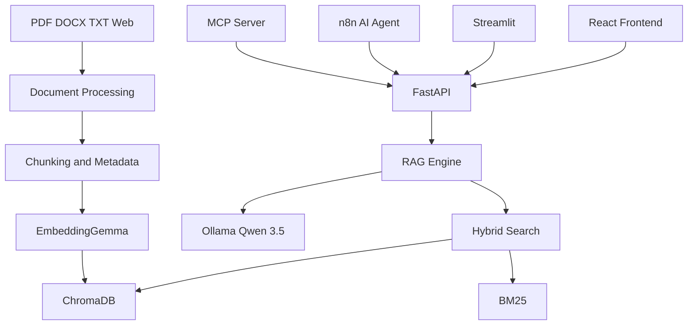

# StudyAL — AI University Assistant

StudyAL, üniversite öğrencilerinin akademik ve idari
bilgilere yapay zekâ desteğiyle erişmesini sağlayan,
RAG tabanlı modüler bir öğrenci destek platformudur.

İstanbul Okan Üniversitesi odaklı geliştirilmektedir.

## Kullanılan Teknolojiler

| Teknoloji | Kullanım Amacı |
|---|---|
| Python | Backend ve veri işleme |
| React | Web arayüzü |
| TypeScript | Frontend geliştirme |
| Vite | Frontend geliştirme ortamı |
| Tailwind CSS | Arayüz tasarımı |
| FastAPI | Merkezi REST API |
| Ollama | Yerel yapay zekâ modelleri |
| Qwen 3.5 4B | Cevap üretimi |
| EmbeddingGemma | Metin vektörleştirme |
| ChromaDB | Vektör veritabanı |
| BM25 | Anahtar kelime tabanlı arama |
| RAG | Kaynak destekli cevap üretimi |
| n8n | AI Agent entegrasyonu |
| MCP | Model Context Protocol |
| Streamlit | Alternatif kullanıcı arayüzü |
| BeautifulSoup | Web veri toplama |

## Sistem Mimarisi



## Temel Özellikler

- Merkezi üniversite bilgi tabanı
- PDF, DOCX ve TXT belge desteği
- Web sitelerinden veri toplama
- Belge yapı analizi
- Chunking ve metadata yönetimi
- Semantik arama
- BM25 hibrit arama
- Reranking
- Kaynak destekli cevap üretimi
- Yerel yapay zekâ modelleri
- React sohbet arayüzü
- Açık ve koyu tema
- Yerel sohbet geçmişi
- Kaynak görüntüleme
- n8n AI Agent entegrasyonu
- MCP Server entegrasyonu

## Proje Yapısı

```text
StudyAL/
├── api/
├── belgeler/
├── belge_isleme/
├── frontend/
├── indeksleme/
├── mcp_server/
├── n8n/
├── rag/
├── tests/
├── test_verileri/
├── veri_toplama/
├── app.py
├── belge_yukle.py
├── web_oku.py
├── requirements.txt
└── README.md
```

## Kurulum

Gereksinimler:

- Python 3.13
- Node.js
- npm
- Git
- Ollama

### Repository

```bash
git clone https://github.com/isaberatozdogan/studyal.git
cd studyal
```

### Python Ortamı

Windows PowerShell:

```powershell
py -m venv .venv
.\.venv\Scripts\python.exe -m pip install -r requirements.txt
```

### Ollama Modelleri

```bash
ollama pull embeddinggemma
ollama pull qwen3.5:4b
```

Ollama servisinin çalıştığından emin olun.

### Belge İndeksleme

Üniversite belgeleri belgeler/ klasöründe tutulur.

ChromaDB veritabanı GitHub üzerinde saklanmaz.
Yeni kurulumda belgelerin mevcut indeksleme
modülleri kullanılarak yeniden indekslenmesi gerekir.

### FastAPI

```powershell
.\.venv\Scripts\python.exe -m uvicorn api.main:app --host 127.0.0.1 --port 8000
```

API: http://127.0.0.1:8000

Swagger: http://127.0.0.1:8000/docs

Health: http://127.0.0.1:8000/health

### React Frontend

Ayrı bir terminalde:

```powershell
cd frontend
npm.cmd ci
npm.cmd run dev
```

Web arayüzü: http://localhost:5173

### Streamlit

Proje ana klasöründe:

```powershell
.\.venv\Scripts\python.exe -m streamlit run app.py
```

### n8n

```powershell
npm.cmd install -g n8n
n8n.cmd start
```

n8n: http://localhost:5678

n8n/studyal_agent.json dosyasını n8n içerisine
import edin.

Ollama ve HTTP bağlantılarını yapılandırın.

Ollama: http://127.0.0.1:11434

StudyAL API: http://127.0.0.1:8000/soru

### MCP Server

```powershell
.\.venv\Scripts\python.exe mcp_server\server.py
```

MCP Server, STDIO transport üzerinden çalışır.

## API Endpoints

| Method | Endpoint | Açıklama |
|---|---|---|
| GET | / | Ana API |
| GET | /health | API durum kontrolü |
| POST | /soru | Yapay zekâ soru-cevap |

Örnek istek:

```json
{
  "soru": "Üniversiteye kayıt için gerekli belgeler nelerdir?"
}
```

## Geliştirme Yol Haritası

- [x] Python altyapısı
- [x] Ollama entegrasyonu
- [x] ChromaDB entegrasyonu
- [x] Embedding sistemi
- [x] Belge işleme
- [x] Chunking
- [x] Metadata yönetimi
- [x] Hibrit arama
- [x] RAG altyapısı
- [x] FastAPI
- [x] n8n Agent
- [x] MCP Server
- [x] React arayüz kodları
- [x] GitHub entegrasyonu
- [ ] React son kullanıcı testleri
- [ ] RAG doğruluk iyileştirmeleri
- [ ] Otomatik web veri güncelleme
- [ ] Akademik takvim paneli
- [ ] Yönetici paneli
- [ ] Kullanıcı hesapları
- [ ] Gelişmiş konuşma hafızası
- [ ] Production deployment

## Proje Durumu

Version: 1.0

Status: Active Development

StudyAL geliştirme aşamasındadır.
Üretilen cevaplar resmi üniversite kaynaklarından
doğrulanmalıdır.
